<p align="center">
  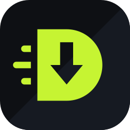
</p>

<h1 align="center">DDM — DedSec Download Manager</h1>

<p align="center">
  <b>The fast, secure download manager and video downloader for Windows — a modern IDM alternative.</b><br>
  Up to 32 connections per file · YouTube, TikTok, Facebook, Instagram and other video sites · Torrents · MEGA · Phone remote<br>
  Windows 11 · 10 · 8.1 · 8 · 7 &nbsp;|&nbsp; Chrome · Edge · Firefox · Opera · Brave · Vivaldi
</p>

<p align="center">
  <a href="https://github.com/officialdedsec/ddm/releases/latest"></a>
  <a href="https://github.com/officialdedsec/ddm/releases/latest"></a>
  
  
  <a href="LICENSE"></a>
  
  <a href="https://github.com/officialdedsec/ddm/stargazers"></a>
</p>

<p align="center">
  <a href="https://github.com/officialdedsec/ddm/releases/latest"><b>⬇ Download DDM for Windows (free and open source)</b></a> &nbsp;·&nbsp;
  <a href="#browser-add-ons">Browser add-ons</a> &nbsp;·&nbsp;
  <a href="#features">Features</a> &nbsp;·&nbsp;
  <a href="#frequently-asked-questions">FAQ</a> &nbsp;·&nbsp;
  <a href="CHANGELOG.md">What's new</a>
</p>

---

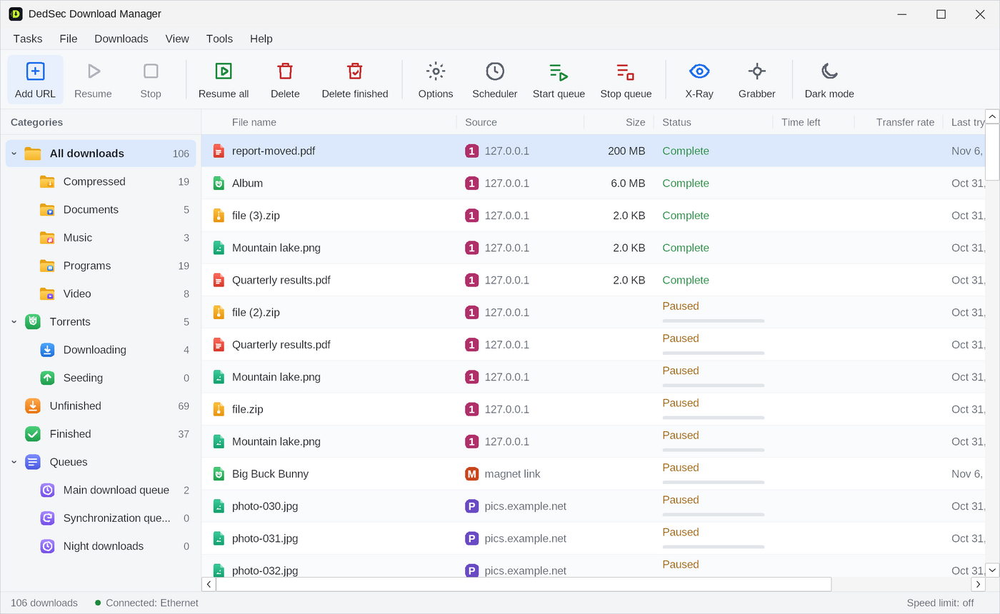

**DDM (DedSec Download Manager)** is a download manager, download accelerator and video downloader for Windows. It splits every file into up to **32 parts downloaded at the same time**, resumes broken and expired downloads, and saves videos from **YouTube, TikTok, Facebook, Instagram, Reels, Bilibili, X (Twitter), Vimeo, Dailymotion, Reddit, Snapchat** and almost any other site with a video player, in **every quality from 144p to 4K or as MP3**. It also downloads **torrents, magnet links and MEGA folders**.

What makes it different is **security**. Before a file reaches your PC, DDM checks **where it comes from and what it really is**: look-alike sites, fake installers, programs disguised as videos or PDFs, sites on public malware lists. Your antivirus only sees a file once it's already on your disk.

DDM is one small native program written in **pure C++**. There's no .NET, Java, Electron or Python, so it starts instantly and uses almost no memory while it waits in the tray.

## Contents

- [Why people switch to DDM](#why-people-switch-to-ddm)
- [Features](#features)
  - [Faster downloads](#-faster-downloads--download-accelerator)
  - [Video downloader](#-video-downloader-for-every-site)
  - [Playlists, channels and subscriptions](#-playlist-and-channel-downloader--subscriptions)
  - [Play while downloading](#-play-while-downloading)
  - [Phone remote](#-phone-remote--control-downloads-from-your-phone)
  - [Torrents and MEGA](#-torrents-magnet-links-and-mega)
  - [Security](#-security-first)
  - [File tools](#-file-tools)
  - [Everything else](#-everything-else)
- [Download and install](#download-and-install)
- [Browser add-ons](#browser-add-ons)
- [Built in pure C++](#built-in-pure-c)
- [Star DDM and share it](#-star-ddm-and-share-it)
- [Free and open source](#free-and-open-source)
- [Build it yourself](#build-it-yourself)
- [Frequently asked questions](#frequently-asked-questions)

## Why people switch to DDM

Looking for an **IDM alternative** or a **free, open-source download manager for Windows**? DDM gives you:

| | DDM |
|---|---|
| Download speed | Up to 32 connections per file, plus all your internet connections at once (Wi-Fi + Ethernet + phone hotspot) |
| Resume | After crashes, restarts and sleep, and even when the link has expired (*Refresh download link*) |
| Video downloader | YouTube, TikTok, Facebook, Instagram, X, Vimeo and other sites, in every quality (4K, 1080p, 720p…) or MP3 |
| Playlists and channels | A whole YouTube playlist or channel in one click, and new videos download by themselves |
| Torrents | Built-in torrent client with magnet links, so you don't need a second program |
| MEGA | Files and whole folders |
| Phone remote | Add, pause and resume downloads from your phone with a QR code |
| Security | Checks links and files *before* they download; X-Ray shows what's inside archives while they're still on the server |
| Weight | One native C++ program, about 10 MB, almost no memory when idle |
| Price | Free for everyone, every feature, no sign-up, no ads |
| Source code | Open source under the GPL-3.0: read it, build it, improve it |

## Features

### 🚀 Faster downloads — download accelerator

- **Up to 32 connections per file.** Every part is checked when it joins the next.
- **Every internet connection at once**: Wi-Fi + Ethernet + phone hotspot added together.
- **Resumes anything**: a dropped connection, a restart, sleep, or an **expired link**. *Refresh download link* continues from the exact byte.
- **Starts the moment the window opens**, so *Start Download* picks up from what has already arrived.
- **A download window like IDM's**: URL, status, size, downloaded, transfer rate, time left and resume capability at a glance, a big progress bar, and a second minimize button in its title bar that hides it in the tray.
- **Clean folders**: unfinished parts wait in DDM's own folder; your folders only ever get finished files.
- **Speed limiter** that lifts itself when nothing else is using the internet.
- **Queues and a scheduler**: download at night, shut down or sleep when finished, and set limits for metered connections.

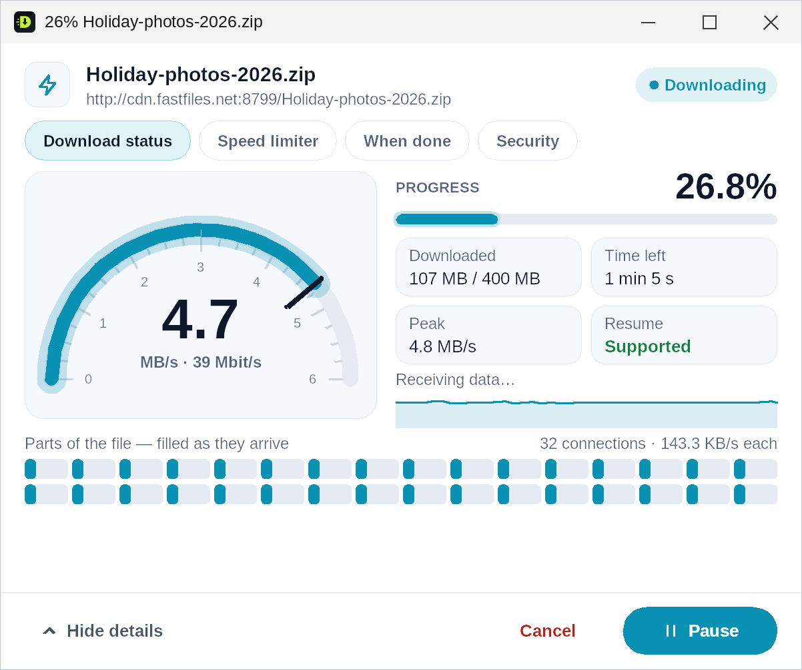

| One tray icon for every download | Drag the finished file anywhere |
|---|---|
| 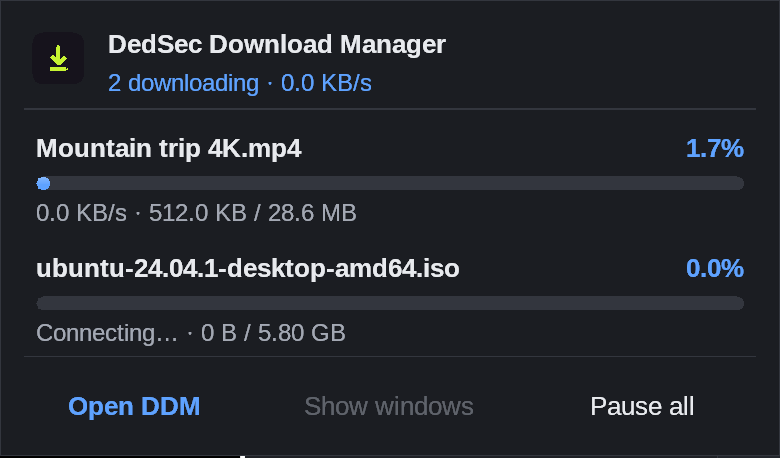 | 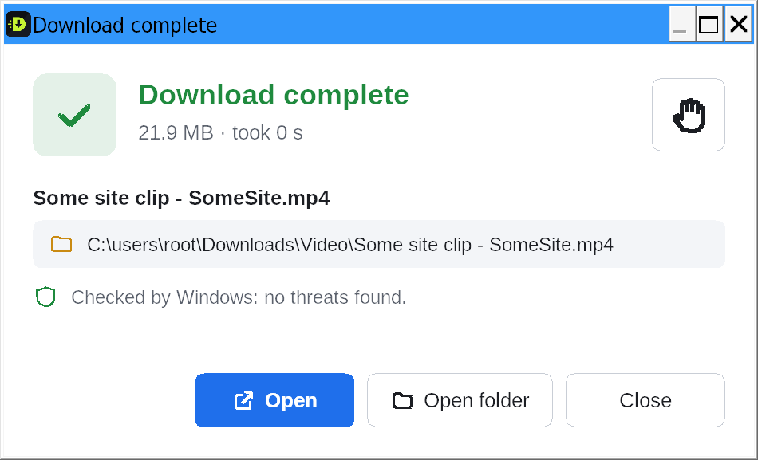 |

### 🎬 Video downloader for every site

- A **"Download this video" button** appears above the videos you watch in your browser. Click it and pick a quality: **4K, 1440p, 1080p HD, 720p, 480p, 360p**, or just the **sound as MP3**.
- **Sites**: YouTube (videos, Shorts and live), TikTok, Facebook (videos and Reels), Instagram (Reels and posts), Threads, Bilibili (up to 4K), Snapchat, X / Twitter, Vimeo, Dailymotion, Reddit, plus any site whose player shows its video in the page, also inside embedded players.
- **Works with what your browser plays**: on sites DDM has no rule for, the add-on notes the stream the page itself plays (HLS, DASH or a plain file, also when its address has no .m3u8 or .mp4 in it) and DDM lists its qualities.
- **Streams (HLS .m3u8 and DASH .mpd)**: every quality, many pieces at a time, encrypted streams (AES-128), separate sound tracks joined. One normal **MP4** comes out without re-encoding. Live streams are recorded until you stop.
- **Adapts by itself**: DDM's site rules update automatically (signed by DedSec) when a site changes, with no new version needed.
- **Real names**: videos are named after their title or caption, never "(20+) Facebook", and hashtags and view counts are left out.
- **Subtitles in every language the video offers**: tick the ones you want and each is saved as an `.srt` next to the video (YouTube, Vimeo, Dailymotion, streams with subtitle tracks, pages whose player lists them). The thumbnail too, if you want it.

| The button over every video | Download Video: every quality |
|---|---|
| 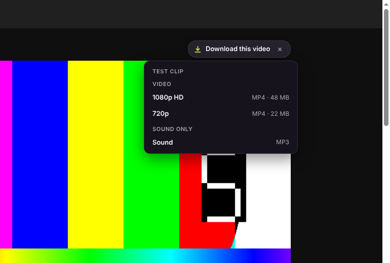 | 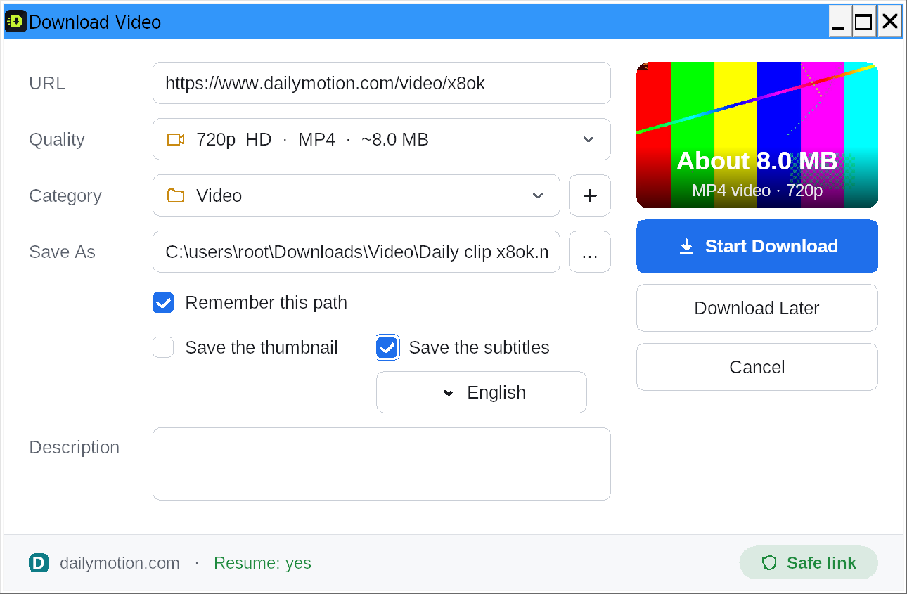 |

### 📃 Playlist and channel downloader + subscriptions

- Paste a **YouTube playlist or channel** link (also `@handle`, Shorts and live tabs). DDM lists **every video**, even in very long playlists.
- Untick what you don't want, choose the quality (up to MP3) and the folder, and click Download.
- **Subscribe** to a playlist or channel and its **new videos download by themselves**, in the quality you chose.

| Download a whole playlist or channel | Subscriptions |
|---|---|
| 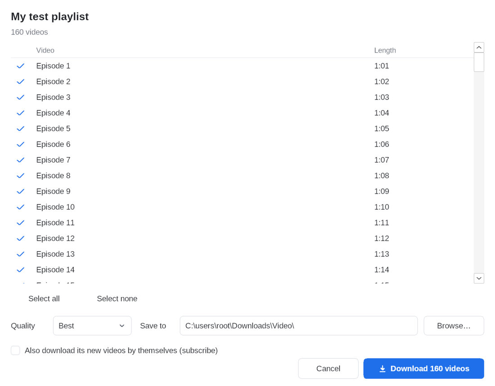 | 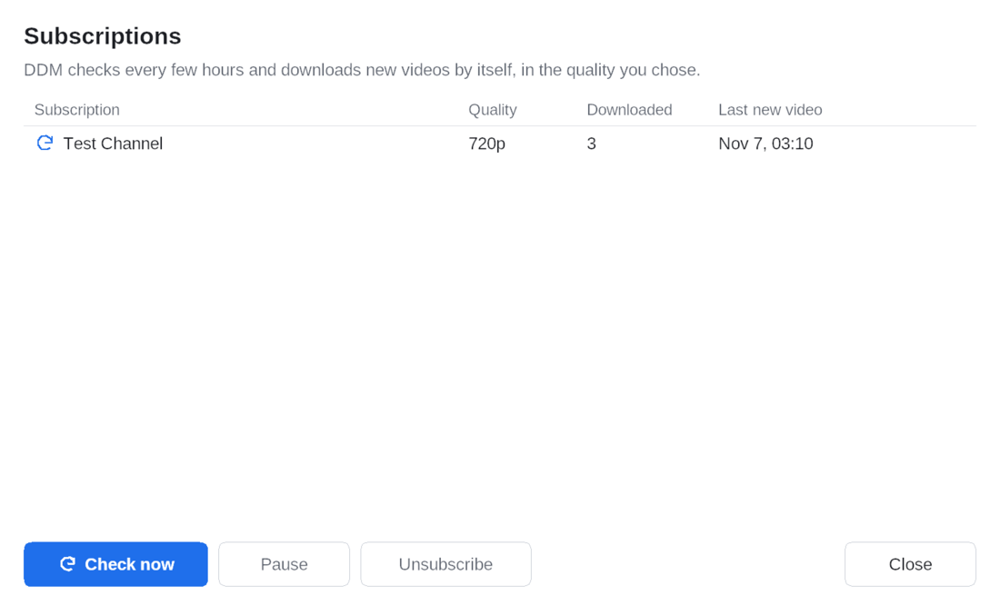 |

### ▶️ Play while downloading

Right-click a video or song and choose **Play while downloading**. When you jump ahead, DDM downloads that part of the file next, so you can start watching in seconds. Formats Windows can't play open in your browser instead.

### 📱 Phone remote — control downloads from your phone

**Tools → Phone remote**: scan the QR code with your phone and you'll see every download with its progress and speed. You can **add links, pause, resume or remove** downloads from your phone, with nothing to install on it. It only works inside your own network and only with the link's secret code.

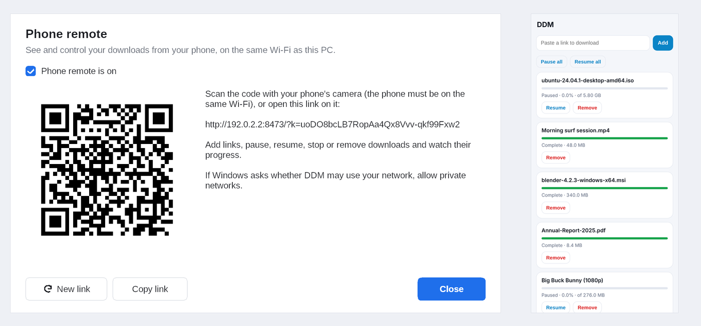

### 🧲 Torrents, magnet links and MEGA

- A fast **built-in torrent client**: magnet links, choose files and their priority, trackers and peers, limits per torrent, seeding until a ratio or time, UPnP / NAT-PMP port forwarding, DHT, peer exchange, encryption, IP blocklist and a watch folder. You can also **create your own torrents**.
- **MEGA** downloads: single files and whole folders.

### 🛡️ Security first

- **Link and site check**: before you click *Start Download*, DDM says whether a link is **Safe**, **Be careful** or **Dangerous**, and why. It looks for look-alike sites (`micros0ft-…`, `paypa1…`), brand-new domains, public malware lists, link shorteners, bare IP addresses, programs disguised as pictures, videos or PDFs, and bait names like "crack" or "keygen".
- **Security tab while it downloads**: the **SHA-256** is worked out as the data arrives and compared with the checksum the site published. Your **antivirus** scans the file the moment it's finished, and it gets Windows' **"from the internet" mark**, so SmartScreen and Office Protected View keep protecting you.
- **X-Ray**: see what's inside a **ZIP, RAR, 7z, ISO, TAR, CAB, torrent or program** while it's still on the server, including who signed a program and risky files hidden in an archive. Then download only the files you want.
- **Private vault** (encrypted, with a decoy password) and a **metadata remover** for photos, videos, music and Office files.

| Link check | X-Ray: look inside before downloading |
|---|---|
| 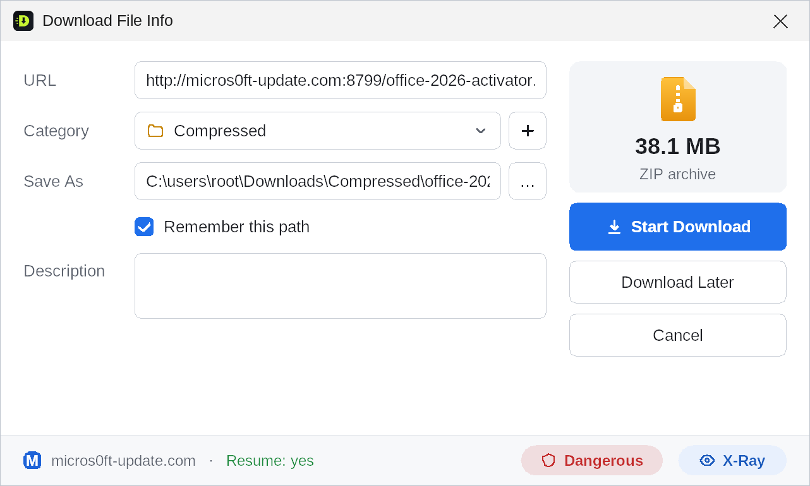 | 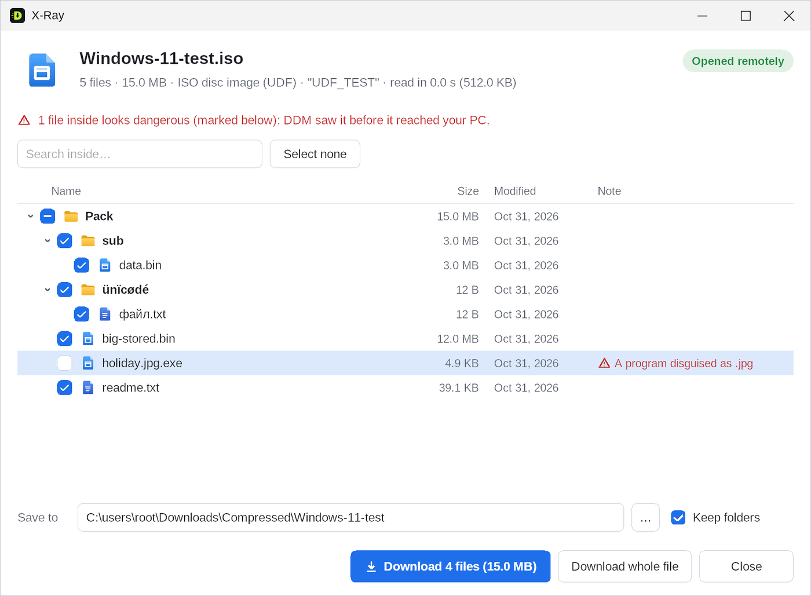 |

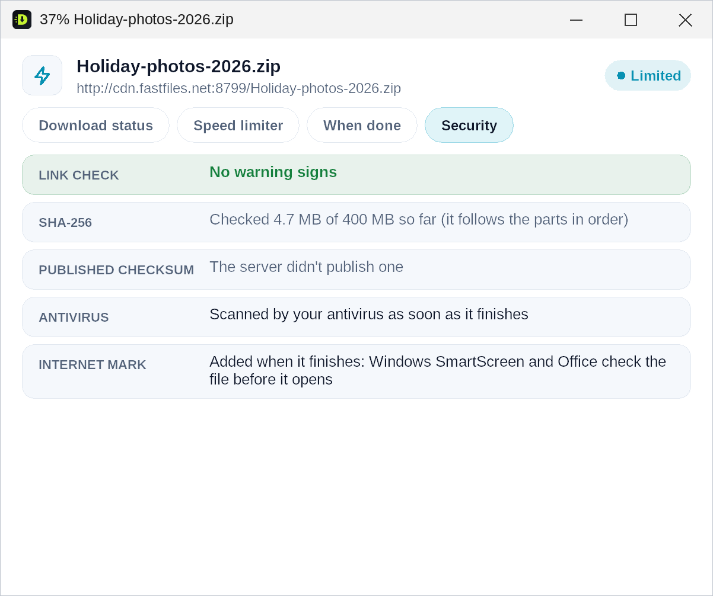

### 🧰 File tools

Right from the download list: **compress video**, **convert to MP3**, **trim**, **video to GIF**, **compress pictures**, **remove an image's background** (on your PC, nothing is uploaded), **extract archives**, **find duplicates** and a **connection speed test**.

| Right-click → File tools | File tools |
|---|---|
| 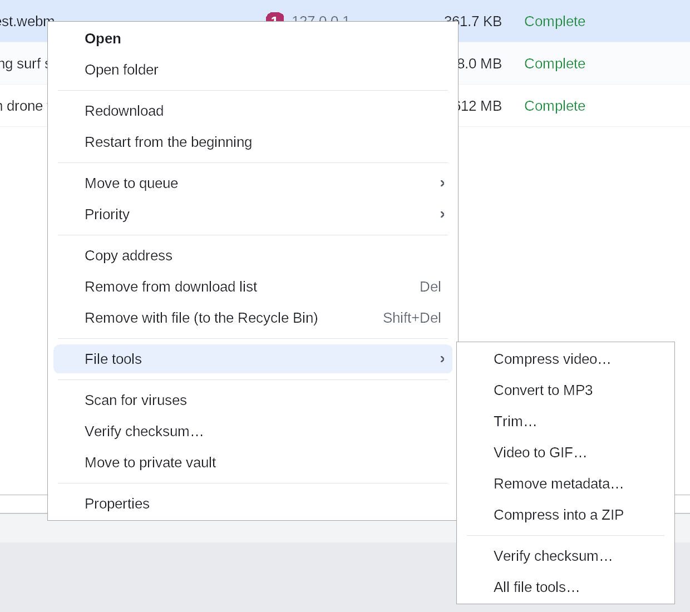 | 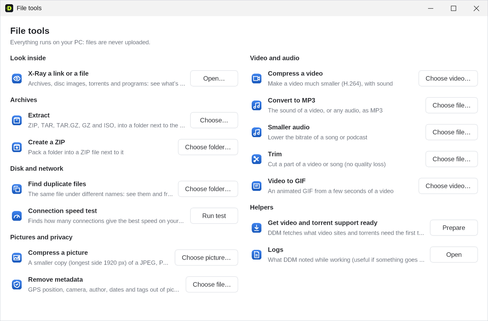 |

### 🌍 In your language
DDM speaks **English, বাংলা (Bengali), हिन्दी (Hindi), اردو (Urdu), العربية (Arabic), Español, Français, Português (Brasil) and Bahasa Indonesia**. Pick one in Options → General → Language (or let DDM follow Windows): every window, menu, message and notification changes at once, with right-to-left reading for Arabic and Urdu.

### ✨ Everything else

- **Browser add-ons** for Chrome, Edge, Firefox, Opera, Brave and Vivaldi: catch downloads, **Download all links / images**, and **Save page as PDF**.
- **Your own categories** with their own file types and folders.
- **Statistics**, sounds, **dark mode**, Find (Ctrl+F), backups of your list, and a full built-in help.
- **Updates itself** quietly and safely: every update is signed and checked twice before it runs.
- Works side by side with Internet Download Manager: DDM asks once which one should catch downloads first.

| Statistics | Scheduler |
|---|---|
| 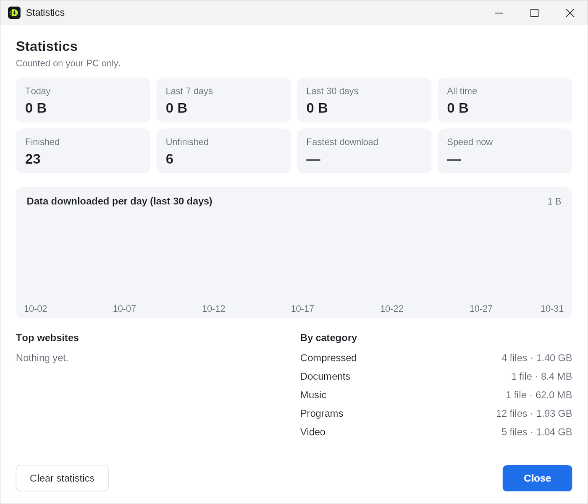 | 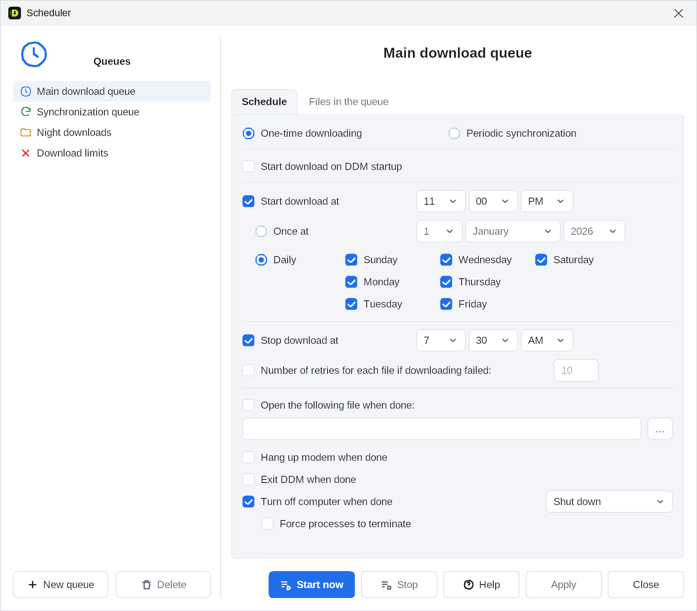 |

## Download and install

1. Download **`DDM-Setup-4.3.2.exe`** from the **[latest release](https://github.com/officialdedsec/ddm/releases/latest)**.
2. Run it. It doesn't need administrator rights and installs for you only.
3. DDM starts and offers its browser add-on. Chrome and Edge also offer it by themselves the next time they start.

**System requirements:** Windows 7 SP1, 8, 8.1, 10 or 11 (32-bit or 64-bit) · about 10 MB of disk space.

> **"Windows protected your PC" / "Unknown publisher"?** DDM is signed by **DedSec Cyber Security Research Institute**. SmartScreen warns about new programs until they build a reputation, so click **More info → Run anyway**. You can check the file first: see [SECURITY.md](SECURITY.md).

**Updating:** DDM checks for new versions by itself and installs them when nothing is downloading (**Help → Check for updates** checks now).
**Uninstalling:** **Settings → Apps → DDM → Uninstall.** DDM asks before removing your downloaded files or its own data.

## Browser add-ons

The add-on puts the **Download this video** button on video sites, sends your browser's downloads to DDM, and adds *Download with DDM*, *Download all links*, *Download all images* and *Save page as PDF* to the right-click menu.

| Browser | Where to get it |
|---|---|
| **Google Chrome** | [Chrome Web Store](https://chromewebstore.google.com/detail/banekiajgcomjfnjkbpknfpgkdgfidjd). DDM also offers it right after setup. |
| **Microsoft Edge** | [Edge Add-ons](https://microsoftedge.microsoft.com/addons/detail/ikafbphbbbilcadhbohghjjcdaghjhdi). DDM also offers it right after setup. |
| **Mozilla Firefox** | [Firefox Add-ons](https://addons.mozilla.org/firefox/addon/ddm-dedsec-download-manager/) |
| **Brave, Opera, Vivaldi** and other Chromium browsers | From the [Chrome Web Store](https://chromewebstore.google.com/detail/banekiajgcomjfnjkbpknfpgkdgfidjd). Opera first needs the *Install Chrome Extensions* add-on. |

**Without the store:** DDM's setup also installs the add-on next to the program (`%LocalAppData%\Programs\DDM\extension\chromium`). Open `chrome://extensions` (or `edge://extensions`), turn on **Developer mode**, click **Load unpacked** and choose that folder. You can also use `ddm-chrome-addon.zip` from the [Releases page](https://github.com/officialdedsec/ddm/releases/latest).

**The browser says it can't reach DDM?** Start DDM once (it introduces itself to your browsers), or use **Options → Browser → Repair**.

| Add DDM to your browser | Welcome page |
|---|---|
| 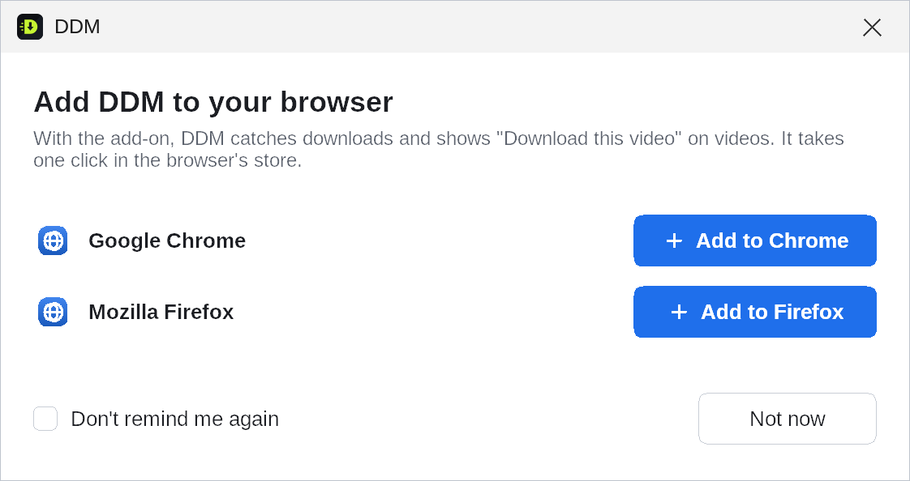 | 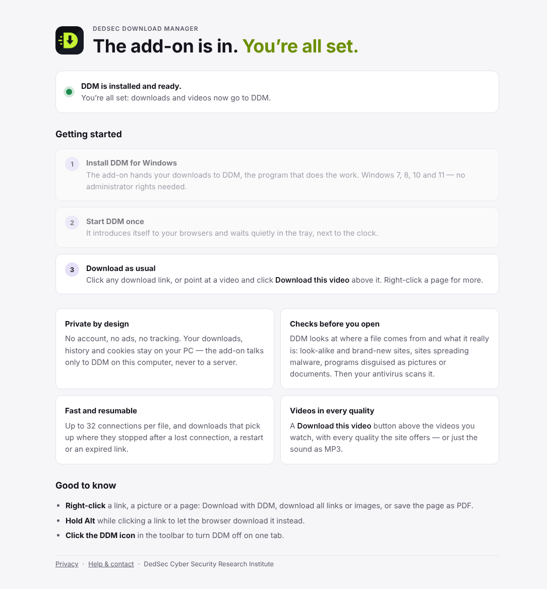 |

## Built in pure C++

DDM is written from the ground up in **pure, native C++** for Windows, using the Win32 API directly with no runtime or framework to install:

- **One small program.** The whole download manager, video engine, torrent client and file tools fit in a single native executable.
- **Instant start, tiny memory use.** There's no .NET, Java, Electron, Python or browser engine underneath, so it waits in the tray using almost nothing.
- **Its own video engine.** DDM reads sites, streams (HLS/DASH), playlists and channels itself, with no outside downloader programs.
- **Runs on old and new PCs alike**, from Windows 7 to Windows 11, 32-bit and 64-bit.
- **Signed** with DedSec's code-signing certificate, and updates are signed too.
- **Open source**: every line is in this repository.

## ⭐ Star DDM and share it

DDM is free, has no ads and is made in the open. If it saved you time, **a star is the best thank-you**: it takes one click, costs nothing, and it is how other people find a good free downloader.

<p align="center">
  <a href="https://github.com/officialdedsec/ddm/stargazers"><b>⭐ Give DDM a star</b></a>
  &nbsp;·&nbsp;
  <a href="https://github.com/officialdedsec/ddm/fork">Fork it</a>
  &nbsp;·&nbsp;
  <a href="https://github.com/officialdedsec/ddm/issues/new/choose">Tell us what to improve</a>
</p>

<p align="center">
  <a href="https://star-history.com/#officialdedsec/ddm&Date">
    
  </a>
</p>

**Know someone who still pays for a download manager, or fights with slow downloads?** Send them DDM:

<p align="center">
  <a href="https://twitter.com/intent/tweet?text=DDM%20%E2%80%94%20a%20free%2C%20open-source%20download%20manager%20for%20Windows%20that%20also%20downloads%20videos%20in%20every%20quality&url=https%3A%2F%2Fgithub.com%2Fofficialdedsec%2Fddm"></a>
  <a href="https://www.facebook.com/sharer/sharer.php?u=https%3A%2F%2Fgithub.com%2Fofficialdedsec%2Fddm"></a>
  <a href="https://www.linkedin.com/sharing/share-offsite/?url=https%3A%2F%2Fgithub.com%2Fofficialdedsec%2Fddm"></a>
  <a href="https://www.reddit.com/submit?url=https%3A%2F%2Fgithub.com%2Fofficialdedsec%2Fddm&title=DDM%3A%20a%20free%2C%20open-source%20download%20manager%20for%20Windows"></a>
  <a href="https://api.whatsapp.com/send?text=DDM%20%E2%80%94%20a%20free%2C%20open-source%20download%20manager%20for%20Windows%3A%20https%3A%2F%2Fgithub.com%2Fofficialdedsec%2Fddm"></a>
  <a href="https://t.me/share/url?url=https%3A%2F%2Fgithub.com%2Fofficialdedsec%2Fddm&text=DDM%20%E2%80%94%20a%20free%2C%20open-source%20download%20manager%20for%20Windows"></a>
</p>

## Free and open source

DDM is made by **DedSec Cyber Security Research Institute** and is **free for everyone**: every feature, no time limit, no sign-up, no ads. Since version 4.3.0 it is also **open source** under the [GNU General Public License, version 3](LICENSE): you may use it, study it, change it and share it, as long as what you share stays under the same licence.

An older DDM had a 30-day trial and licence keys. That is gone: update, and a DDM that was locked after its trial works again.

- **Found a bug or have an idea?** [Open an issue](https://github.com/officialdedsec/ddm/issues/new/choose) or send a pull request: see [CONTRIBUTING.md](CONTRIBUTING.md).
- **Official builds** are the ones on the [Releases page](https://github.com/officialdedsec/ddm/releases), signed by DedSec. A copy you build yourself works the same, without that signature.

## Build it yourself

The whole program is in this repository: `src/` (the program), `extension/` (the browser add-ons), `installer/`, `res/` (icons, help, languages) and `tools/` (translations). It is built on Linux with MinGW-w64 into one 32-bit program for Windows 7 to 11:

```sh
./build.sh          # out/DDM.exe, out/ddmhost.exe and the add-ons
```

[BUILDING.md](BUILDING.md) lists the compiler and the libraries it needs (curl, Mbed TLS, libtorrent, OpenSSL, Boost, miniz) and how to build them.

## Frequently asked questions

**What is the best IDM alternative for Windows?**
DDM covers what people use Internet Download Manager for (multi-connection downloads, resume, browser integration, a video download button and a scheduler) and adds torrents, MEGA, playlist and channel downloads, a phone remote and security checks before each download. It is free and open source.

**How do I download YouTube videos and playlists?**
Install DDM and its browser add-on, open the video and click **Download this video**. For a whole playlist or channel, paste its link into DDM (**Tasks → Download playlist or channel…**).

**Can DDM download TikTok, Facebook, Instagram and Reels videos?**
Yes. Point at the video and click **Download this video**. Each video is saved under its own caption or title.

**Can I download a video as MP3?**
Yes. Choose **Sound only (MP3)** in the button's menu, or **MP3** in the quality list.

**Does DDM replace my antivirus?**
No. It adds checks your antivirus doesn't make (where a file comes from and what it pretends to be), then hands the finished file to your antivirus.

**Does DDM work with Internet Download Manager installed?**
Yes. DDM asks once which one should catch downloads first.

**Is DDM really free?**
Yes: every feature, for everyone, with no time limit, and its source code is here under the GPL-3.0.

**Is my data private?**
Yes. There's no account, no ads and no tracking, and you can read the source code to check. Your downloads, history and cookies stay on your PC, and the browser add-on talks only to DDM on your own computer.

**Where are my files?**
In your Downloads folder, sorted into Compressed, Documents, Music, Programs and Video (plus your own categories). You can change this in **Options → Save to**.

**I found a bug or have an idea.**
Please [open an issue](https://github.com/officialdedsec/ddm/issues/new/choose). For security problems, see [SECURITY.md](SECURITY.md).

---

<p align="center">
  <b>DDM — DedSec Download Manager</b>: download manager · download accelerator · IDM alternative · video downloader · YouTube downloader · playlist downloader · TikTok downloader · Facebook video downloader · Instagram Reels downloader · MP3 converter · torrent client · magnet link downloader · MEGA downloader · HLS / m3u8 downloader · for Windows 11, 10, 8 and 7
</p>
<p align="center">© 2026 DedSec Cyber Security Research Institute · <a href="LICENSE">GPL-3.0</a> · <a href="https://dedseec.com/privacy">Privacy</a> · <a href="https://dedseec.com/contact">Contact</a> · <a href="mailto:admin@dedseec.com">admin@dedseec.com</a></p>
